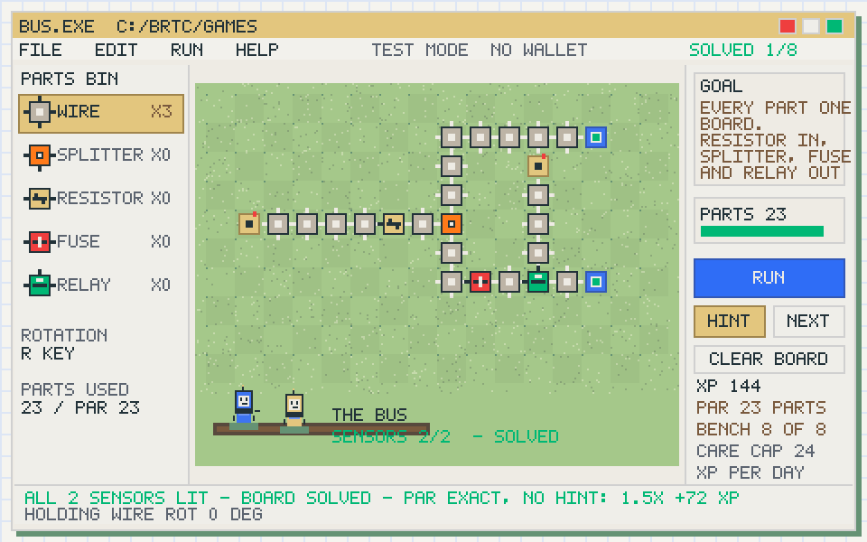

# BUS.EXE -- BENCH (P0)

A playable proof of the "workshop district" idea: a deterministic circuit bench that
runs as one offline HTML file. Built to show the concept is real, not to integrate yet.

**Play it:** https://htmlpreview.github.io/?https://cdn.jsdelivr.net/gh/D0xedDevi0/D0xedDev@8482e46/br-bus-p0/bench.html

- Single file, zero dependencies, zero network calls, no wallet, no testnet.
- Place WIRE / SPLITTER / RESISTOR / FUSE / RELAY, connect SOURCE to SENSOR.
- `R` rotates, right-click pulls a part, `ENTER` runs the board.
- 8 benches, authored par, 25% XP on repeats, 24 pads/day care cap.

`SOLVER_NOTES.md` carries the part rules, the verification output and an explicit
list of what is NOT proven. `src/` rebuilds `bench.html` (see the notes).

Scratch artifact branch, not main.
